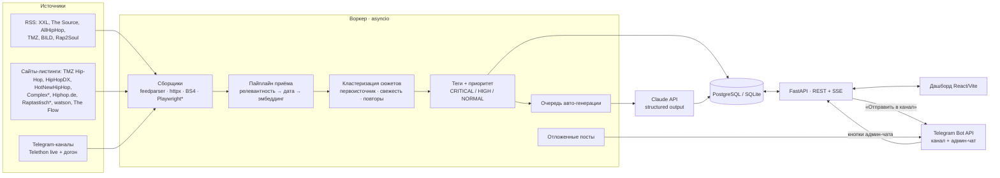

# 🔊 SQANDAL RADAR

Автоматический мониторинг хип-хоп индустрии (🇷🇺 СНГ, 🇩🇪 Deutschrap, 🇺🇸 US) для Telegram-канала **@SQANDALru**:
сбор новостей каждые 15 минут и из Telegram-каналов в реальном времени → склейка дублей по смыслу →
проверка даты первоисточника → авто-теги и приоритет → готовый пост в голосе канала (Claude API) →
редактор и публикация в канал через Bot API.

Публикация в канал всегда решение редактора: кнопка в дашборде, кнопка в админ-чате или запланированное время.

---

## Архитектура


`*` — сайт рисуется JavaScript'ом, нужен Playwright (Chromium).

| Процесс | Что делает | Запуск |
|---|---|---|
| **worker** | сбор (RSS/сайты раз в 15 мин, Telegram — сразу), дедуп, теги, приоритет, авто-генерация, отложенный постинг, протухание сюжетов, админ-чат (polling) | `python -m sqandal.worker` |
| **api** | REST для дашборда, SSE-поток обновлений, генерация «жёстче» по кнопке, публикация, вебхук Telegram | `uvicorn sqandal.api.app:app` |
| **frontend** | SPA: лента по сценам, теги и приоритеты, редактор поста с предпросмотром «как в канале» | `npm run dev` / собранная статика внутри api |

```
backend/
  sqandal/
    collectors/   rss.py · web.py · article.py (дата первоисточника) · browser.py (Playwright) · telegram.py (Telethon) · http.py
    processing/   ingest.py (пайплайн) · clustering.py · embeddings.py · tagging.py · freshness.py
    llm/          prompts.py (голос канала) · claude.py (Messages API) · generator.py · factcheck.py
    publish/      formatter.py (HTML / MarkdownV2) · telegram_bot.py (Bot API)
    api/          app.py · schemas.py
    services.py   генерация, правка, публикация, планирование, кнопки админ-чата
    worker.py     все фоновые циклы
    models.py     схема БД (SQLAlchemy 2.0)
    cli.py        init-db · collect · generate · tg-login · demo · snapshot · calibrate · dump-schema · set-webhook
    snapshot.py   снимок реальных новостей для демо-дашборда (пайплайн с часами «как у воркера»)
  config/         sources.yaml · tags.yaml · artists.yaml
  db/             schema.postgres.sql · schema.sqlite.sql (сгенерированы из models.py)
  snapshot/       реальные публикации на дату снимка: items.json (пересказ фактов) + posts.json
  tests/          50 тестов: сборщики, дедуп, LLM-запрос, публикация, API, SSE, Playwright, PostgreSQL
frontend/         React 19 + Vite, без UI-библиотек; дизайн — система CITITOOL «Präzision» (styles.css)
```

---

## Быстрый старт

### Docker (PostgreSQL + API + воркер)
```bash
cp .env.example .env          # DASHBOARD_TOKEN, ANTHROPIC_API_KEY, TG_BOT_TOKEN
docker compose up -d --build
open http://localhost:8000    # вход по DASHBOARD_TOKEN
```
Первый сбор начнётся сразу. Модель эмбеддингов (~0.5 ГБ) скачается при первом запуске воркера.
Сборка поменьше: `docker compose build --build-arg WITH_ML=0 --build-arg WITH_BROWSER=0`
(дедуп через Voyage или hashing, без JS-сайтов).

### Локально
```bash
make setup                    # venv, зависимости, Chromium, npm install, .env
make api                      # терминал 1 — http://localhost:8000
make worker                   # терминал 2
make web                      # терминал 3 — http://localhost:5173 (прокси /api → :8000)
```

### Демо без ключей и сети
```bash
make demo-web                 # дашборд со встроенными вымышленными сюжетами
# или вымышленные данные через настоящий бэкенд:
make demo && make demo-api    # + make web
```
Опубликованный дашборд (артефакт в Claude) открывается в режиме **«Реальные новости»** — по-русски:
- сюжеты лежат в базе артефакта; кнопка **«Обновить»** запускает задачу в облаке Claude (задание —
  `artifact/collector-prompt.md`): она открывает те же сайты, что в `config/sources.yaml`, отбирает хип-хоп
  новости за 36 часов, склеивает дубли, фиксирует время первоисточника, пишет русский пост по правилам
  редакции и кладёт всё в базу — лента обновляется сама, обычно за 5–15 минут;
- приоритет, «старый факт» и фактчек чисел страница считает сама — по тем же весам и правилам, что бэкенд
  (`frontend/src/demo/newsroom.js`); «Жёстче» и «Сгенерировать пост» пишет Claude из аккаунта зрителя;
- вкладка **«Статья»** в редакторе: Claude пишет по источникам сюжета маленькую статью — лид и 3–5 абзацев,
  до ~2500 знаков (одно сообщение Telegram); правила голоса и фактов те же (`ARTICLE_INSTRUCTIONS` в
  `backend/sqandal/llm/prompts.py`, рендер абзацев — `kind="article"` в обоих форматтерах);
- **«Собрать факты»** на той же вкладке: Claude сводит факты из всех источников сюжета в один список, у каждого
  пункта — издания, где он есть. Галочками отмечаешь, что идёт в текст, → **«Написать статью из отмеченных»**:
  статья пишется только из отмеченных пунктов, тексты источников в запрос уже не попадают (`FACTS_INSTRUCTIONS`,
  `ARTICLE_FROM_FACTS` в `prompts.py`). Отметки сохраняются в сюжете — можно поменять и переписать;
- бота нет: пост копируется в Telegram вручную.

Что читает сбор по кнопке: XXL, The Source, AllHipHop, TMZ, HipHopDX, HotNewHipHop, Complex · Hiphop.de, Raptastisch,
Rap2Soul, watson.ch · The Flow · Telegram: Рифмы и Панчи, The Flow, NR, Mash, Baza, SHOT (через веб-версию t.me/s;
у Mash, Baza и SHOT — только посты про рэперов). RAP.RU пока исключён из автоматического сбора: лента рисуется
скриптом, и сбор видит пустую страницу. Недоступны из облака: BILD, Spiegel, Focus (инструмент чтения сайтов их не
открывает), X и Instagram (нужен вход) — поэтому SayCheese, Akademiks, No Jumper напрямую не читаются; их истории
быстро подхватывают AllHipHop и HotNewHipHop. Серверная версия (`config/sources.yaml`) читает BILD и Telegram-каналы
напрямую.

ID задачи — `TRIGGER_ID` в `frontend/src/demo/liveApi.js`. Для другого аккаунта: создай в Claude задачу без
расписания с текстом из `artifact/collector-prompt.md` (поменяй в нём ссылку на свой артефакт) и впиши её ID.

Без Claude (локально, `make demo-web`) открывается встроенный снимок реальных новостей
(`backend/snapshot/2026-10-21`), прогнанный через пайплайн бэкенда. Переключатель в верхней плашке —
**«Вымышленное демо»**: артисты и издания выдуманы, «публикация» никуда не уходит, через ~12 секунд
«прилетает» новый CRITICAL.

Свой снимок: положи `items.json` и `posts.json` в `backend/snapshot/<дата>/` и выполни
```bash
cd backend && python -m sqandal.cli snapshot snapshot/<дата> --export ../frontend/src/demo/snapshot-data.json
```
Публикации «приходят» в момент выхода (приоритет считается тогда же), а на момент снимка сюжеты
старше `STALE_AFTER_HOURS` помечаются «старым фактом» — как это делает воркер.

---

## Настройка Telegram

**Публикация (Bot API)**
1. @BotFather → `/newbot` → токен в `TG_BOT_TOKEN`.
2. Добавь бота администратором в @SQANDALru с правом «Публикация сообщений».
3. `TG_CHANNEL_ID=@SQANDALru` (для приватного канала — числовой id `-100…`).

Пост уходит `sendMessage` с `parse_mode=HTML` (или `MarkdownV2`, `POST_PARSE_MODE`), превью — ссылка
первоисточника через `link_preview_options`. Счётчик до лимита 4096 символов — в редакторе.

**Админ-чат с кнопками** (необязательно): CRITICAL-черновик приходит тебе в личку с кнопками
«✅ В канал / 🔥 Жёстче / ⏭ Пропустить».
- `TG_ADMIN_CHAT_ID` — твой id (напиши боту @userinfobot), сначала нажми у своего бота «Start».
- `TG_ADMIN_MODE=polling` — работает без публичного адреса (домашний сервер).
- `TG_ADMIN_MODE=webhook` + `PUBLIC_BASE_URL` + `TG_WEBHOOK_SECRET` → `python -m sqandal.cli set-webhook`.
  Telegram присылает секрет в заголовке `X-Telegram-Bot-Api-Secret-Token`, чужие запросы — 403.
Кнопки принимаются только из `TG_ADMIN_CHAT_ID`. Старый факт из админ-чата не публикуется — только из дашборда с подтверждением.

**Парсер каналов (Telethon, user-аккаунт)**
1. https://my.telegram.org → API development tools → `TG_API_ID`, `TG_API_HASH`.
2. `python -m sqandal.cli tg-login` → телефон, код, 2FA → строку `TG_SESSION=…` в `.env`.
   Это ключ к аккаунту — храни как пароль. Лучше отдельный аккаунт.
3. Впиши каналы в `config/sources.yaml` (`kind: telegram`, `channel: username`).

Live-события `NewMessage`/`MessageEdited` + догон пропущенного по курсору `msg_id` после рестарта.
У репоста берётся `fwd_from.date` — время **оригинала**, а не репоста.

---

## Источники (проверено 19–21.10.2026)

| Сцена | Источник | Как берём | Статус |
|---|---|---|---|
| 🇺🇸 | XXL | RSS `xxlmag.com/feed/` | работает, в ленте только тизеры → полный текст докачивается перед генерацией |
| 🇺🇸 | The Source | RSS `thesource.com/feed/` | точное время; спорт и игры отсекает фильтр хип-хопа |
| 🇺🇸 | AllHipHop | RSS `allhiphop.com/feed/` | быстро подхватывает истории SayCheese, Akademiks, No Jumper (сами они в X/Instagram) |
| 🇺🇸 | TMZ | листинг рубрики `/hip-hop/` + общий RSS с фильтром хип-хопа | рубрик в RSS нет; дубли рубрики и RSS склеиваются по URL |
| 🇺🇸 | HipHopDX | листинг `/news` | открытого RSS не нашёл |
| 🇺🇸 | HotNewHipHop | листинг главной + фильтр хип-хопа | RSS нет; на листинге только даты — время берётся из статьи |
| 🇺🇸 | Complex | листинг `/music` через Playwright | JS-сайт; фид не отдаётся; рейтинги/подборки отсекаются |
| 🇩🇪 | Hiphop.de | листинг главной (`/magazin/news/…-ID`) | RSS нет |
| 🇩🇪 | Raptastisch | листинг главной (`/ГГГГ/ММ/ДД/…`) через Playwright | уличные конфликты и бифы; лента на JS и за Cloudflare |
| 🇩🇪 | Rap2Soul | RSS `rap2soul.de/feed` + фильтр хип-хопа | есть R&B и поп — фильтр их отсекает |
| 🇩🇪 | BILD | автопоиск фида на странице RSS-лент BILD + фильтр хип-хопа | из моей среды сайт закрыт — проверь после запуска во вкладке «Источники» |
| 🇩🇪 | rap.de | — | **закрыт издателем** (Piranha Media), лента стоит с 2022 — в конфиге выключен |
| 🇨🇭 | watson | листинг главной + фильтр хип-хопа | общее СМИ — только новости о рэперах |
| 🇷🇺 | The Flow | листинг главной (`/news/…`) | RSS нет |
| 🇷🇺 | RAP.RU | листинг `/news` через Playwright | **выключен 21.10.2026**: лента рисуется скриптом (Tilda), сбор видит пустую страницу |
| 🇷🇺 | Telegram: Рифмы и Панчи, The Flow, NR, Mash, Baza, SHOT | Telethon | у общих каналов (Mash, Baza, SHOT, Рифмы) — фильтр хип-хопа |

Вёрстка сайтов меняется. Если у источника нет ссылок по `link_pattern`, сбор падает с понятной ошибкой,
а дашборд показывает его красным во вкладке «Источники». Вежливость: `robots.txt` соблюдается,
условные GET (ETag/Last-Modified), не больше 2 запросов к одному хосту одновременно, бэкофф после ошибок.

---

## Дедупликация и верификация

1. **Точные дубли** — тот же канонический URL (без utm/www/фрагмента), тот же текст (хэш), или TG-пост
   со ссылкой на статью: инсайд часто выходит раньше СМИ и ссылается на него — склеиваются без эмбеддингов.
2. **Смысловые дубли** — мультиязычные эмбеддинги (`paraphrase-multilingual-MiniLM-L12-v2`): одна и та же
   новость на русском, немецком и английском попадает в один сюжет. Онлайн-кластеризация в окне 72 ч:
   близость к центроиду сюжета ≥ порога **и** к ближайшей публикации ≥ порога − 0.05 (без «цепочек»).
   Порог выше, если в новостях разные артисты из вотчлиста (+0.10) или непересекающиеся теги событий (+0.05) —
   «Drake: альбом» и «Drake: иск» не склеятся. Подобрать порог на своих данных: `python -m sqandal.cli calibrate`.
   Альтернативы: `EMBEDDING_BACKEND=voyage` (рекомендация Anthropic для эмбеддингов) или `hashing` (без ML).
3. **Дата первоисточника** — у каждой публикации `effective_at` и уверенность:
   JSON-LD `datePublished` / meta `article:published_time` / RSS `pubDate` / время поста Telegram — точно;
   `<time>`, дата обновления, дата без часового пояса — примерно; дата из URL или время обнаружения — не подтверждена.
   Дата из будущего (кривой часовой пояс CMS) отбрасывается. Статья старше 7 дней в ленте — архив, не новость.
4. **Первоисточник сюжета** = самая ранняя проверенная публикация. Дашборд показывает её время,
   возраст и шкалу свежести.
5. **Защита от старья**: сюжет старше `STALE_AFTER_HOURS` (24 ч) или похожий на уже опубликованный за 14 дней
   помечается, и «Отправить в канал» требует подтверждения.
6. **Независимые источники** считаются по изданию: TMZ из RSS и TMZ из рубрики — один источник.

**Приоритет** (`config/tags.yaml`): вес главного тега + 30% остальных + бонусы за независимые источники,
за ≥3 издания в первые 2 часа («горит»), за артиста из вотчлиста; штраф за «только инсайд» и за старый факт.
CRITICAL ≥ 60 (смерть, задержание), HIGH ≥ 30 (суд, здоровье, скандал), остальное — NORMAL.
Теги ловятся регулярками на трёх языках с исключениями: «Death Row Records» — не смерть,
«выпустили под залог» — не релиз, «rap sheet» — не рэп.

---

## LLM: генерация поста

- Прямой вызов **Claude Messages API** (`llm/claude.py`, без SDK), модель `claude-sonnet-5-5`,
  `output_config.format` — JSON Schema (структурированный ответ гарантирован API), `effort: low`.
  У Sonnet 5.5 принудительный `tool_choice` и `temperature` дают 400 — поэтому их нет; это закреплено тестом.
- Системный промпт (голос канала + правила фактов) кэшируется (`cache_control`) — он одинаковый для всех сюжетов.
- Вход: первоисточник + по одному документу от каждого другого издания (до 5), с датой, типом (СМИ / Telegram)
  и уверенностью в дате. Ответ: флаг, эмодзи темы, заголовок, 3–4 факта, итог, теги, заметки для редактора.
- **Голос**: news-first, уличный, напористый, без кринж-сленга и воды; жёсткость в подаче, не в фактах.
  Только факты из источников, презумпция невиновности («задержан», «по данным TMZ»), медицина — только
  сообщённая, «по данным инсайдеров», если подтверждения нет.
- **«Перегенерировать жёстче»** → режимы `harder` → `hardest`: модель получает предыдущий черновик и
  ужимает подачу, не трогая факты.
- **Фактчек**: каждое число в посте ищется в текстах источников (с учётом «$25,000» = «25 000», «six» = 6);
  не нашлось — предупреждение в редакторе.
- Стоимость: порядка 1–2 центов за пост на Sonnet 5.5 (≈3 тыс. токенов входа, ≈0.5–1 тыс. выхода, системный
  промпт из кэша). Авто-генерация — только для свежих сюжетов (`AUTO_GENERATE_MAX_AGE_HOURS`), остальное по кнопке.

Формат поста (форматтер `publish/formatter.py`, его JS-копия — для живого предпросмотра в дашборде):
```
🇺🇸🚨 <b>Lil Static задержан в Атланте после погони</b>

▪️ 18 октября рэпера задержали после погони полиции по трассе I-85 — по данным Demo Wire.
▪️ Обвинения: незаконное хранение оружия (felony — тяжкое преступление) и марихуаны.
▪️ Залог — $25 000, вышел примерно через шесть часов.

<blockquote>Тур стартует 1 ноября — теперь под вопросом каждая дата.</blockquote>

📎 <a href="…">Demo Wire</a> · <a href="…">Demo Beat</a>
<a href="https://t.me/SQANDALru">🔊 SQANDAL</a>
```

---

## База данных

PostgreSQL в проде, SQLite для разработки — одна схема (`sqandal/models.py`), DDL:
[`backend/db/schema.postgres.sql`](backend/db/schema.postgres.sql), [`backend/db/schema.sqlite.sql`](backend/db/schema.sqlite.sql).
Таблицы создаются при старте; DDL проверен на PostgreSQL 16.

| Таблица | Назначение | Ключевые поля |
|---|---|---|
| `sources` | источники из `sources.yaml` и их здоровье | `key`, `kind`, `scene`, `state` (найденный фид), `etag`/`last_modified`, `tg_last_message_id`, `last_success_at`, `last_error`, `consecutive_failures` |
| `news_items` | каждая публикация каждого источника | `external_id` (уникален в источнике), `canonical_url`, `published_at` + `date_source` + `date_confidence`, `effective_at`, `content_hash`, `embedding`, `cluster_id`, `is_relevant`, `tg_*`, `fwd_from` |
| `clusters` | сюжеты — одно событие из многих источников | `origin_item_id`, `origin_published_at`, `first_seen_at`, `sources_count`, `verification`, `tags`, `artists`, `priority`/`priority_score`, `is_stale`, `republish_of_cluster_id`, `needs_refresh`, `centroid` |
| `posts` | версии поста по сюжету и публикация | `version`, `mode` (standard/harder/hardest/manual), `status`, поля поста, `body_html`, `warnings`, токены, `scheduled_at`, `tg_message_id` |
| `fetch_runs` | журнал прогонов сборщиков | `ok`, `items_seen`, `items_new`, `error`, `duration_ms` |
| `app_state` | команды воркеру («собрать сейчас») | `key`, `value` |

Эмбеддинги хранятся как `float32`-байты; поиск по активному окну (72 ч) идёт в памяти воркера — pgvector не нужен.

---

## API

Все маршруты, кроме `/api/health` и вебхука, — с `Authorization: Bearer <DASHBOARD_TOKEN>`.

| Метод | Путь | Что делает |
|---|---|---|
| GET | `/api/stories?scene=ru\|de\|us\|all&priority=&tag=&status=active&q=&sort=time\|priority` | лента сюжетов |
| GET | `/api/stories/{id}` | сюжет: все публикации, текущий пост, версии |
| POST | `/api/stories/{id}/generate` `{mode}` | сгенерировать / «жёстче» |
| POST | `/api/stories/{id}/dismiss` · `/restore` | скрыть / вернуть |
| PATCH | `/api/posts/{id}` | ручная правка (фактчек пересчитывается) |
| POST | `/api/posts/{id}/publish` `{confirm_stale}` | в канал; 409 `stale_confirmation_required` для старого факта |
| POST / DELETE | `/api/posts/{id}/schedule` | запланировать / снять |
| GET | `/api/stream?token=` | SSE: `story` (обновлённая карточка), `stats` |
| GET | `/api/stats` · `/api/sources` · `/api/config` | счётчики, здоровье источников, настройки поста |
| POST | `/api/collect` | собрать сейчас |
| POST | `/api/telegram/webhook` | кнопки админ-чата (секрет в заголовке) |

---

## Тесты

```bash
make test
# + PostgreSQL:
SQANDAL_TEST_PG=postgresql+psycopg://postgres@localhost:5432/sqandal_test make test
```
Покрыто: RSS/Atom и условные GET, автопоиск фида, извлечение даты (JSON-LD/@graph, meta без пояса, `<time>`, URL),
листинги и robots.txt, windows-1251, Telethon-сообщения и репосты, теги на трёх языках и исключения, склонения
имён, приоритеты, свежесть, кластеризация (разные артисты не склеиваются), пайплайн целиком, формат запроса к
Claude API и ретраи (529, `max_tokens`, отказ), фактчек, HTML/MarkdownV2, публикация и ошибки Bot API,
планирование, весь API, вебхук, SSE через живой uvicorn, Playwright на JS-странице, сквозной прогон на PostgreSQL.

---

## Конфиги

- `config/sources.yaml` — источники; новый сайт без RSS = `kind: web` + `link_pattern` (регулярка URL статей).
- `config/tags.yaml` — теги, регулярки, веса и пороги приоритета.
- `config/artists.yaml` — вотчлист: поднимает приоритет и не даёт склеить истории разных артистов;
  `footnote` — обязательная сноска к посту, если артист упомянут.
- `.env` — ключи и поведение (полный список с пояснениями — `.env.example`).
